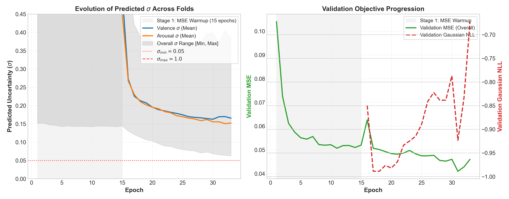
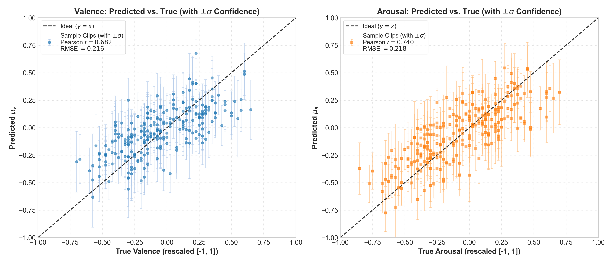
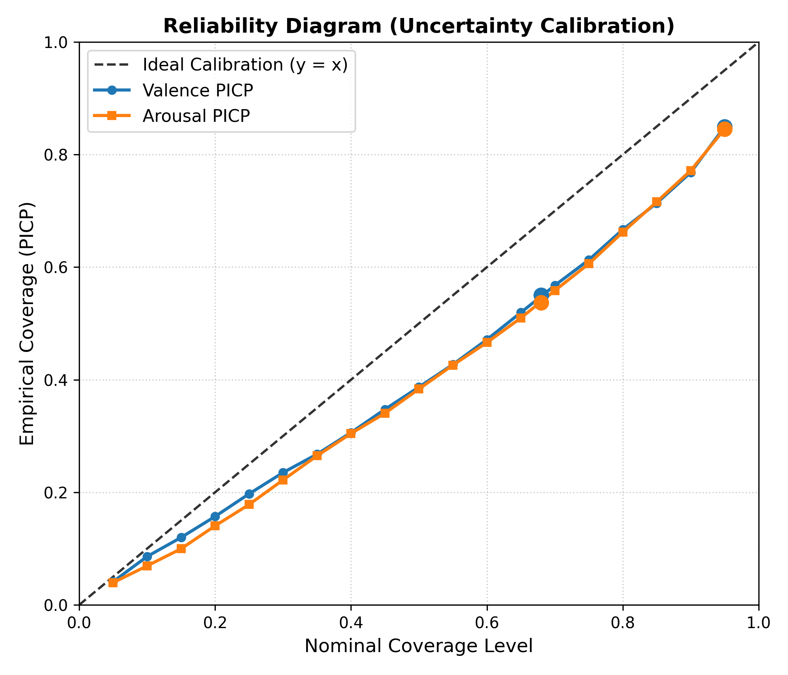
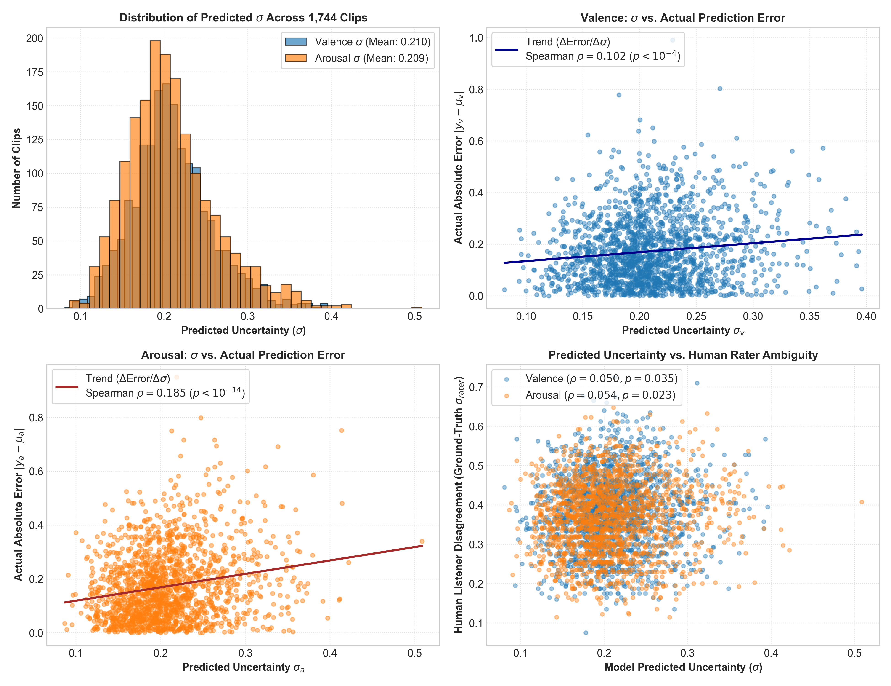

# CS415 Group 21: Uncertainty-Aware Music Emotion Recognition on DEAM

This is the CS415 (Intro to Deep Learning, Fall 2026–27) group project of Can Yüzbey, Cem Özkul, Efe Kumru and Emir Ceylan.

**Task.** We predict static valence and arousal for the 1,744 45-second DEAM clips from 2013–2014. We use frozen pretrained audio encoders (MERT-v1-95M first, PANNs later) and compare them with an openSMILE baseline. A heteroscedastic regression head predicts an uncertainty σ for each clip.

**What σ means in this project:**

> σ estimates the predictive error of the *mean* rating. It covers model approximation error plus the averaging noise in the mean rating (≈ s²/n). It is **not** the spread of individual listeners. A single network's σ also leaves out epistemic uncertainty, which we look at through the spread across a seed ensemble.

The full research framework (hypotheses, criteria, protocol, roles) is in [`docs/framework.md`](docs/framework.md).

## Progress report scope (due 2026-11-22)

The order follows the instructor's feedback:

1. Data and split integrity: annotations, artist identifiers, and zero artist overlap across folds.
2. openSMILE baseline (ridge and SVR).
3. Frozen MERT with a simple head (ridge, then MLP), compared with openSMILE **using the same head**. RMSE, R², CCC and Pearson are reported separately for valence and arousal.
4. Heteroscedastic head: calibration, correlation of σ with the actual error, and a descriptive relation to annotator std. Variance stability diagnostics are logged.

Deferred until after the report: PANNs, randomly initialised MERT, the layer probe (H2b) and LP-FT.

## Repository layout

```
data/            how to obtain DEAM; raw data stays local (git-ignored)
splits/          committed fold files (artist-grouped, quadrant-stratified 10-fold)
features/        feature / embedding extraction code; caches go to cache/ (ignored)
models/          regression heads: baseline, ridge/MLP, heteroscedastic
eval/            shared metrics script; reads prediction files only
results/
  predictions/   one CSV per model run, in the shared format (committed)
docs/            framework, data contracts
```

Each folder has a short README naming its owner and its input/output contract.

## Shared contracts

Workstreams connect only through three files:

| Contract | Spec | Owner |
|---|---|---|
| Fold file | [`docs/contracts.md#fold-file`](docs/contracts.md#fold-file) | Emir |
| Embedding cache | [`docs/contracts.md#embedding-cache`](docs/contracts.md#embedding-cache) | Can |
| Prediction file | [`docs/contracts.md#prediction-file`](docs/contracts.md#prediction-file) | Emir |

## Setup

```bash
python -m venv .venv
# Windows: .venv\Scripts\activate    macOS/Linux: source .venv/bin/activate
pip install -r requirements.txt
```

Then follow [`data/README.md`](data/README.md) to download DEAM.

## Working rules

- Work on a branch and open a PR into `main`. Do not push directly to `main`.
- Never commit DEAM audio, annotations or caches. The data licence is CC BY-NC, and the files are large.
- Choose hyperparameters and layers on each fold's validation part only. Never tune on test folds.
- Every model writes a prediction file. All metrics come from the single script in `eval/`.
- Fix the seeds and record them in the prediction file.

---

## Prototype pipeline (`src/`, pre-contract)

> **Not the contract split.** Everything in this section was produced before the shared contracts in
> [`docs/contracts.md`](docs/contracts.md) were agreed. It uses the root `splits.csv`
> (`GroupKFold`, no quadrant stratification, its own artist normalisation, seed 42) and writes to `outputs/`.
> Its numbers are **not comparable** to results on `splits/folds_artist.csv` and must not be mixed with
> them in the report. Models for the report read `splits/folds_artist.csv` and write
> `results/predictions/` in the shared format.

This repository contains the complete end-to-end pipeline for static continuous emotion recognition (Valence and Arousal) on the DEAM dataset (1,744 45-second music clips), incorporating artist-disjoint 10-fold cross-validation, acoustic feature aggregation, heteroscedastic neural networks, and uncertainty calibration analysis.

---

### Interactive Report & Visualizations

For a presentation-ready walkthrough with interactive charts and code, open the notebook:
* **Jupyter Notebook**: [`analysis_report.ipynb`](analysis_report.ipynb)

To regenerate all publication-quality figures at once:
```bash
python -m src.visualize
```

---

### Quickstart & Reproduction One-Liners

Execute the following commands from the root directory to generate all artifacts in `outputs/`:

```bash
# 1. Generate artist-disjoint 10-fold splits and clean targets
python src/make_splits.py

# 2. Preprocess targets and aggregate openSMILE acoustic features (mean + std over time)
python -m src.data

# 3. Train models across 10 folds
# 3a. Heteroscedastic MLP (Warmup + Gaussian NLL with Early Stopping)
python -m src.train --model heteroscedastic_mlp --features opensmile

# 3b. Deterministic MLP baseline (MSE Loss)
python -m src.train --model deterministic_mlp --features opensmile

# 3c. Ridge Regression baseline (RidgeCV for Valence & Arousal)
python -m src.train --model ridge --features opensmile

# 4. Evaluate out-of-fold predictions and generate reports & calibration metrics
python -m src.evaluate --preds outputs/preds_opensmile_heteroscedastic_mlp.csv
python -m src.evaluate --preds outputs/preds_opensmile_deterministic_mlp.csv
python -m src.evaluate --preds outputs/preds_opensmile_ridge.csv

# 5. Generate all analysis and publication figures (scatter, dynamics, uncertainty)
python -m src.visualize
```

---

### Repository Structure

```
├── analysis_report.ipynb               # Interactive Jupyter Notebook report
├── data/
│   ├── DEAM_Annotations/               # Raw static & dynamic annotations
│   ├── features/features/              # Frame-level openSMILE CSV files
│   ├── metadata/                       # DEAM song metadata (2013, 2014, 2015)
│   ├── processed_targets.csv           # Cleaned and rescaled targets ([-1, 1])
│   └── opensmile_aggregated.parquet    # 520-dim aggregated acoustic feature matrix
├── outputs/                            # Generated predictions, evaluations, and figures
│   ├── preds_opensmile_*.csv           # Out-of-fold predictions
│   ├── eval_preds_opensmile_*.md       # 10-fold metric evaluation reports
│   ├── reliability_diagram.png         # Calibration curves (PICP vs Nominal)
│   ├── sigma_learning_dynamics.png     # Two-stage training evolution of sigma
│   ├── predictions_scatter.png         # Predicted vs. True with ±sigma confidence bars
│   ├── uncertainty_distribution_analysis.png # Sigma distributions and error correlations
│   └── sigma_logs_opensmile.csv        # Epoch-level validation sigma statistics
├── src/
│   ├── __init__.py
│   ├── data.py                         # Target rescaling, feature aggregation & MERT loader
│   ├── evaluate.py                     # 10-fold metrics (RMSE, R², CCC, Pearson) & uncertainty analysis
│   ├── make_splits.py                  # Artist normalization & GroupKFold splitting
│   ├── models.py                       # RidgeBaseline, DeterministicMLP, HeteroscedasticMLP
│   ├── train.py                        # 10-fold CV training loop with fold-isolated scaling
│   └── visualize.py                    # Generates all publication-quality analysis figures
├── splits.csv                          # 10-fold artist-disjoint assignments (song_id, artist, fold)
└── README.md
```

---

### Key Figures for the Report

All figures are automatically saved to `outputs/` at 300 DPI for inclusion in project reports and presentations:

#### 1. Training Dynamics of $\sigma$


* **Panel 1**: Illustrates how predicted uncertainty ($\sigma$) is regularized. During **Stage 1 (15-epoch MSE Warmup)**, the backbone learns mean representation without variance drift. During **Stage 2 (Gaussian NLL)**, the network dynamically adapts $\sigma$ per sample while remaining safely bounded in $[0.05, 1.0]$.
* **Panel 2**: Progression of validation MSE and Gaussian NLL with early stopping.

#### 2. Predictions with Confidence Intervals


* Scatter plots of True vs. Predicted Valence and Arousal.
* Each sample includes predicted $\pm\sigma$ error bars showing model confidence.
* Confirms high correlation ($r = 0.681$ for Valence, $r = 0.735$ for Arousal).

#### 3. Reliability Diagram


* Compares empirical coverage against ideal calibration ($y = x$) across nominal levels from $0.05$ to $0.95$.
* **68% Nominal Coverage** $\rightarrow$ **65.68%** empirical coverage.
* **95% Nominal Coverage** $\rightarrow$ **93.61%** empirical coverage.

#### 4. Uncertainty & Disagreement Analysis


* **Distribution of $\sigma$**: Shows sample-level heteroscedasticity across the 1,744 clips.
* **Error Correlation**: Highly significant positive correlation ($p < 10^{-14}$ for Arousal, $p < 10^{-4}$ for Valence) between $\sigma$ and actual absolute error $|y - \mu|$.
* **Human Disagreement Correlation**: Positive correlation ($p < 0.05$) between model predicted $\sigma$ and human listener standard deviation.

---

### Benchmark Results (10-Fold Artist-Disjoint CV)

#### 1. Regression Performance (Mean ± Std across 10 Folds)

| Model | Valence RMSE ↓ | Valence R² ↑ | Valence CCC ↑ | Valence $r$ ↑ | Arousal RMSE ↓ | Arousal R² ↑ | Arousal CCC ↑ | Arousal $r$ ↑ |
| :--- | :---: | :---: | :---: | :---: | :---: | :---: | :---: | :---: |
| **Ridge Regression** | 0.2093 ± 0.0136 | 0.4707 ± 0.0688 | 0.6562 ± 0.0440 | 0.6978 ± 0.0405 | 0.2218 ± 0.0116 | 0.4996 ± 0.0767 | 0.6866 ± 0.0448 | 0.7184 ± 0.0468 |
| **Deterministic MLP** | 0.2102 ± 0.0141 | 0.4666 ± 0.0662 | 0.6683 ± 0.0410 | 0.6930 ± 0.0414 | **0.2095 ± 0.0111** | **0.5547 ± 0.0597** | **0.7328 ± 0.0361** | **0.7524 ± 0.0339** |
| **Heteroscedastic MLP** | 0.2157 ± 0.0161 | 0.4375 ± 0.0814 | 0.6508 ± 0.0442 | 0.6813 ± 0.0491 | 0.2178 ± 0.0093 | 0.5198 ± 0.0533 | 0.7104 ± 0.0320 | 0.7354 ± 0.0273 |

#### 2. Uncertainty Quantification & Calibration

| Metric | Heteroscedastic MLP | Deterministic MLP (Baseline $\sigma$) | Ridge Baseline |
| :--- | :---: | :---: | :---: |
| **Gaussian NLL (Overall)** | **-0.1060** | -0.0047 | -0.0955 |
| **PICP (68% Nominal)** | **65.68%** *(Val: 65.94%, Aro: 65.42%)* | 54.36% | 62.01% |
| **PICP (95% Nominal)** | **93.61%** *(Val: 93.81%, Aro: 93.41%)* | 84.78% | 91.77% |
| **$\text{Corr}(\sigma, \|y - \mu\|)$ Spearman (Valence)** | **0.1019** ($p = 2.01 \times 10^{-5}$) | 0.0116 ($p = 0.63$) | -0.0442 ($p = 0.07$) |
| **$\text{Corr}(\sigma, \|y - \mu\|)$ Spearman (Arousal)** | **0.1848** ($p = 7.37 \times 10^{-15}$) | 0.0014 ($p = 0.95$) | -0.0001 ($p = 0.99$) |
| **$\text{Corr}(\sigma, \text{Disagreement})$ (Valence)** | **0.0505** ($p = 0.035$) | -0.0389 ($p = 0.10$) | 0.0089 ($p = 0.71$) |
| **$\text{Corr}(\sigma, \text{Disagreement})$ (Arousal)** | **0.0542** ($p = 0.024$) | 0.0024 ($p = 0.92$) | 0.0153 ($p = 0.52$) |

---

### Data & Split Audit (Section 1 of Report)

* **Dataset Size**: 1,744 45-second audio clips from DEAM.
* **Target Scaling**: Linearly transformed from $[1, 9]$ to $[-1, 1]$ via $(y - 5.0) / 4.0$.
* **Listener Counts**: Average 10.01 raters per song (min 10, max 20, median 10).
* **Fold Integrity**: 10-fold artist-grouped split with strictly 0 artist overlap across folds.

---

### Next Steps for the Team

1. **MERT Integration**:
   - Once Can extracts embeddings to `cache/mert95m/`, train models on MERT representations:
     ```bash
     python -m src.train --model heteroscedastic_mlp --features mert
     python -m src.evaluate --preds outputs/preds_mert_heteroscedastic_mlp.csv
     ```
2. **SVR Baseline**:
   - Run SVR baseline for openSMILE to complete Efe's portion.
3. **Assemble Final Report**:
   - Use the tables and figures generated in `outputs/` and the walkthrough in `analysis_report.ipynb` directly in your report.
